

## 🗺️ Map

[Reges](#reges) · [Web, design and motion](#web) · [Products](#products) · [Client work](#clients) · [Roleplay and game servers](#roleplay) · [Open source](#open-source) · [Stack](#stack) · [Activity](#activity) · [Work with us](#work-with-us)

**LIKE A KING INC.** is a New York software company. We design and build websites, online ordering and booking systems, dashboards, apps and private AI for businesses, and we run our own products alongside client work.

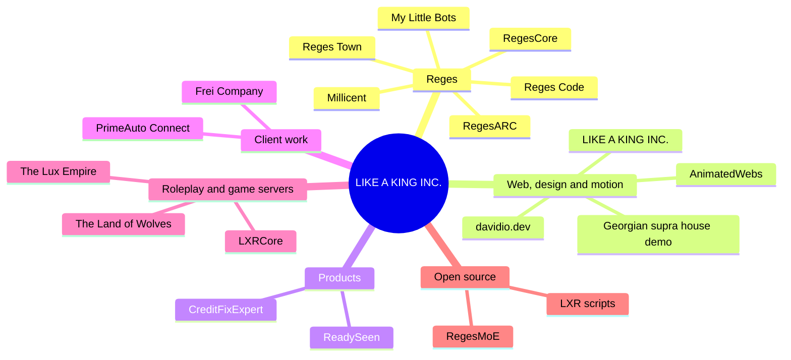

<h2 id="reges">🤖 Reges: private AI platform</h2>

A local-first AI OS whose agents ask before they send, post, pay or share anything. Runs on your own PC or your own server.

<table>
<tr>
<td width="50%" valign="top">
<a href="https://regescore.pro">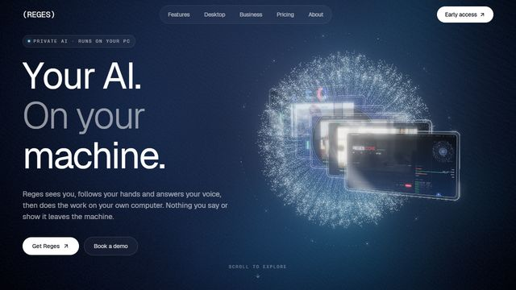</a>

<b><a href="https://regescore.pro">RegesCore</a></b> 
The Reges platform: private AI assistants, automation and dashboards for people and businesses. 

</td>
<td width="50%" valign="top">
<a href="https://regescode.com">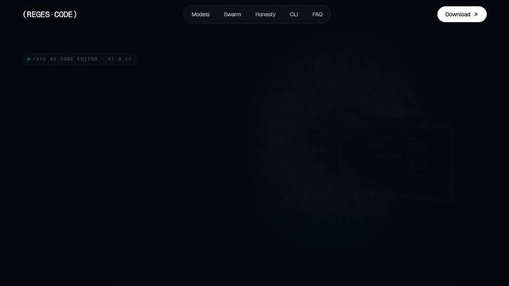</a>

<b><a href="https://regescode.com">Reges Code</a></b> 
An AI code editor for developers, with licences and automatic updates. 

</td>
</tr>
<tr>
<td width="50%" valign="top">
<a href="https://regestown.com">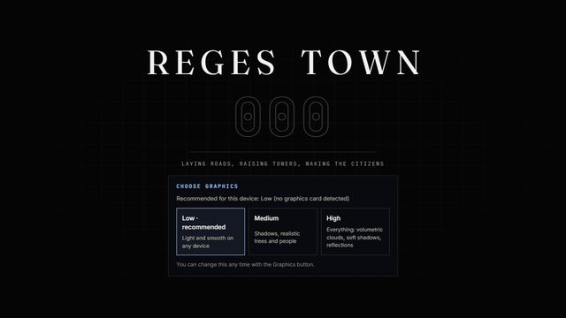</a>

<b><a href="https://regestown.com">Reges Town</a></b> 
A living 3D town of AI characters, streamed live around the clock. 

</td>
<td width="50%" valign="top">
<a href="https://regesarc.com">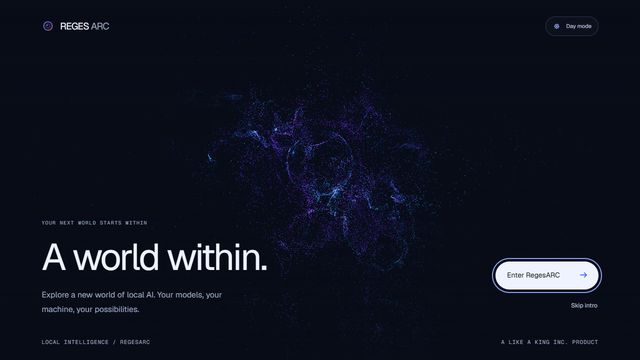</a>

<b><a href="https://regesarc.com">RegesARC</a></b> 
Research: running bigger AI models on everyday 12 GB graphics cards. 
 
</td>
</tr>
<tr>
<td width="50%" valign="top">
<a href="https://heymillicent.com">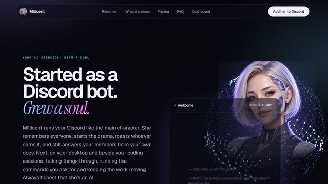</a>

<b><a href="https://heymillicent.com">Millicent</a></b> 
An AI community member for Discord servers that chats, helps and plays. 

</td>
<td width="50%" valign="top">
<a href="https://mylittlebots.com">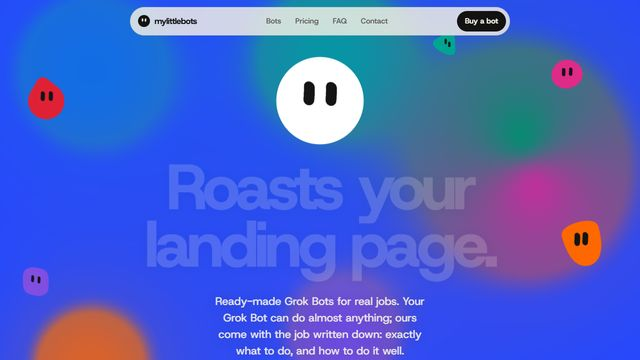</a>

<b><a href="https://mylittlebots.com">My Little Bots</a></b> 
Custom AI bot designs. 

</td>
</tr>
</table>

<h2 id="web">🎨 Web, design and motion</h2>

Cinematic websites, templates and the tools behind them.

<table>
<tr>
<td width="50%" valign="top">
<a href="https://animatedwebs.com">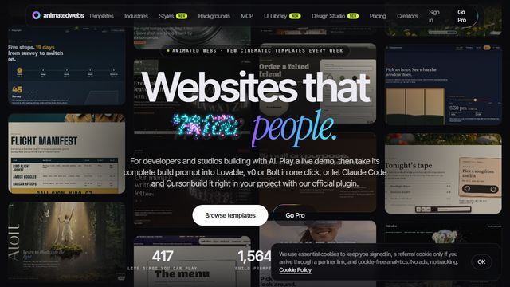</a>

<b><a href="https://animatedwebs.com">AnimatedWebs</a></b> 
Animated, cinematic website templates, plus a Claude Code plugin with 1,200+ templates through MCP. 
 
</td>
<td width="50%" valign="top">
<a href="https://animatedwebs.com/demos/tamada-supra-house/index.html">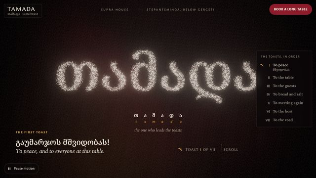</a>

<b><a href="https://animatedwebs.com/demos/tamada-supra-house/index.html">Georgian supra house demo</a></b> 
A restaurant template: WebGL particles, menu, booking and hours. The base for our restaurant builds. 

</td>
</tr>
<tr>
<td width="50%" valign="top">
<a href="https://likeakinginc.com">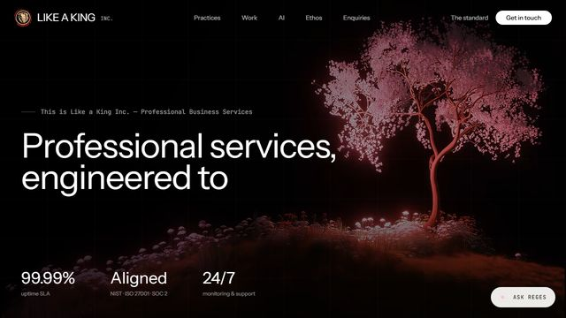</a>

<b><a href="https://likeakinginc.com">LIKE A KING INC.</a></b> 
Web development, hosting and AI for businesses: websites, online ordering, dashboards and apps. 

</td>
<td width="50%" valign="top">
<a href="https://davidio.dev">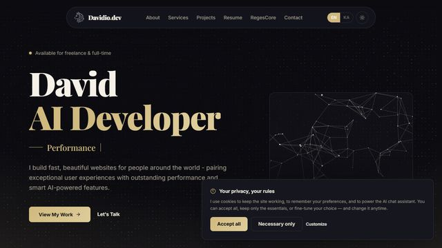</a>

<b><a href="https://davidio.dev">davidio.dev</a></b> 
Our developer studio: web development and AI integrations. 

</td>
</tr>
</table>

<h2 id="products">💼 Products</h2>

Software we run and sell.

<table>
<tr>
<td width="50%" valign="top">
<a href="https://readyseen.com">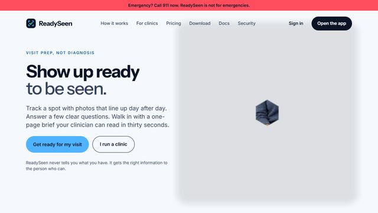</a>

<b><a href="https://readyseen.com">ReadySeen</a></b> 
Patients prepare for doctor visits and book clinics online. Clinics get a ready brief and an inbox. 

</td>
<td width="50%" valign="top">
<a href="https://creditfixexpert.com">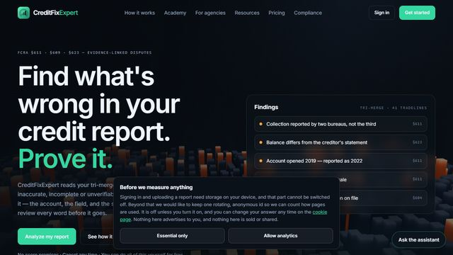</a>

<b><a href="https://creditfixexpert.com">CreditFixExpert</a></b> 
A credit-repair platform with client accounts and online payments. 

</td>
</tr>
</table>

<h2 id="clients">🤝 Client work</h2>

Built for clients, end to end.

<table>
<tr>
<td width="50%" valign="top">
<a href="https://primeautoconnect.net">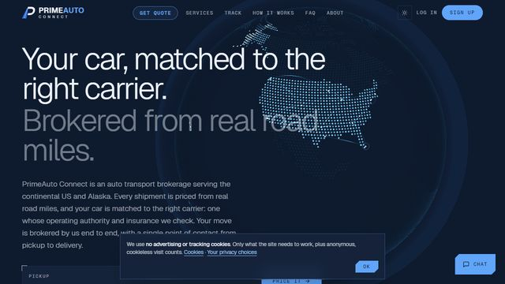</a>

<b><a href="https://primeautoconnect.net">PrimeAuto Connect</a></b> 
Auto transport: online quotes, booking, e-signed contracts, live vehicle tracking and a full CRM dashboard. 

</td>
<td width="50%" valign="top">
<a href="https://freicompany.ge">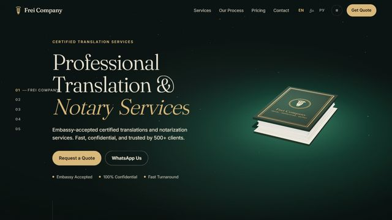</a>

<b><a href="https://freicompany.ge">Frei Company</a></b> 
A company website, designed and built end to end. 

</td>
</tr>
</table>

<h2 id="roleplay">🎮 Roleplay and game servers</h2>

Frameworks, scripts and communities for RedM and FiveM.

<table>
<tr>
<td width="50%" valign="top">
<a href="https://www.lxrcore.com">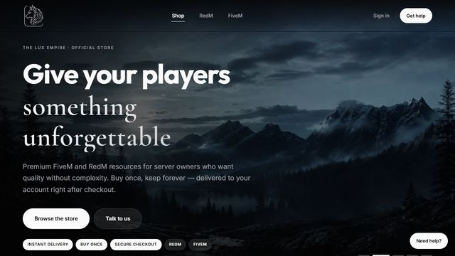</a>

<b><a href="https://www.lxrcore.com">LXRCore</a></b> 
A modular, fast RedM roleplay framework, with farming, hunting, police and economy modules. 

</td>
<td width="50%" valign="top">
<a href="https://wolves.land">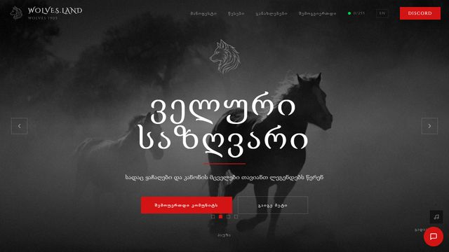</a>

<b><a href="https://wolves.land">The Land of Wolves</a></b> 
A roleplay community: website, server and systems. 

</td>
</tr>
<tr>
<td width="50%" valign="top">
<a href="https://theluxempire.com">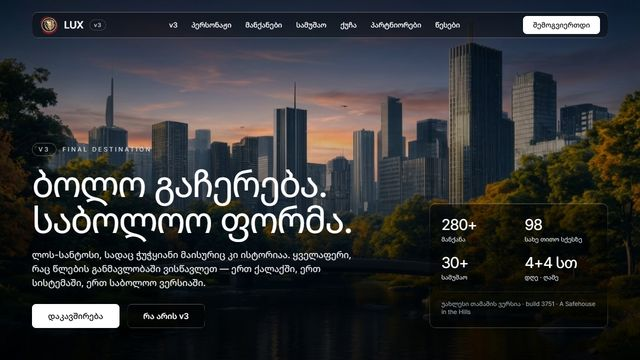</a>

<b><a href="https://theluxempire.com">The Lux Empire</a></b> 
A roleplay community: website, server and systems. 

</td>
<td width="50%"></td>
</tr>
</table>

<b>LXR scripts for RedM and FiveM</b> (open source)

[`LXRCore-Police-System`](https://github.com/iboss21/LXRCore-Police-System) [`lxr-mdt`](https://github.com/iboss21/lxr-mdt) [`lxr-tattoos`](https://github.com/iboss21/lxr-tattoos) [`lxr-whitelist`](https://github.com/iboss21/lxr-whitelist) [`lxr-pedscale`](https://github.com/iboss21/lxr-pedscale) [`lxr-fight`](https://github.com/iboss21/lxr-fight) [`lxr-drag`](https://github.com/iboss21/lxr-drag) [`lxr-voicerange`](https://github.com/iboss21/lxr-voicerange) [`lxr-spirits`](https://github.com/iboss21/lxr-spirits) [`lxr-minigames`](https://github.com/iboss21/lxr-minigames) [`lxr-doorhash`](https://github.com/iboss21/lxr-doorhash) [`lx-inventory`](https://github.com/iboss21/lx-inventory) [`RedM-Server-Economic-System-Structure`](https://github.com/iboss21/RedM-Server-Economic-System-Structure)

<h2 id="open-source">🧪 Open source</h2>

| Repo | What it does |
|---|---|
| [**RegesMoE**](https://github.com/iboss21/RegesMoE) | Run RegesCore models on a normal PC: one installer, a local OpenAI/Anthropic-compatible API |
| [**regescore-benchmark**](https://github.com/iboss21/regescore-benchmark) | Benchmark your local LLMs |
| [**gguf-editor**](https://github.com/iboss21/gguf-editor) | Inspect and edit GGUF model files |
| [**llm-trainer**](https://github.com/iboss21/llm-trainer) | Local single- and multi-GPU GGUF manager |
| [**claude-lmstudio**](https://github.com/iboss21/claude-lmstudio) | Connection and API-error fixes for Claude with LM Studio |
| [**git-pr-extractor**](https://github.com/iboss21/git-pr-extractor) | Extract, upload and download GitHub PRs from a Windows UI |

<h2 id="stack">🧰 Stack</h2>

<h2 id="activity">📈 Activity</h2>

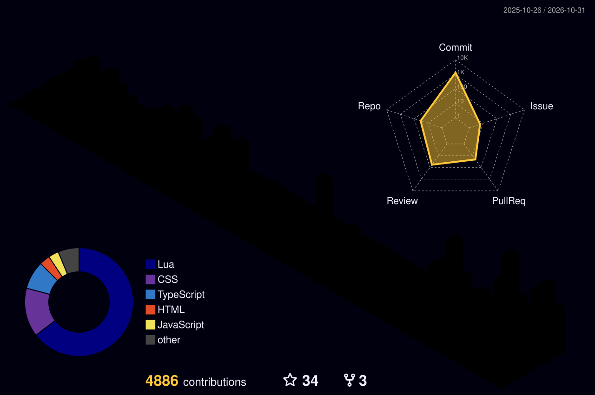

<picture>
  <source media="(prefers-color-scheme: dark)" srcset="assets/generated/snake-dark.svg">
  
</picture>

<h2 id="work-with-us">📫 Work with us</h2>

Need a website that takes orders, a booking system, a dashboard, an app or private AI for your business?

Status badges check each site live · cards are screenshots of the real sites · the 3D city and snake rebuild daily from contributions

